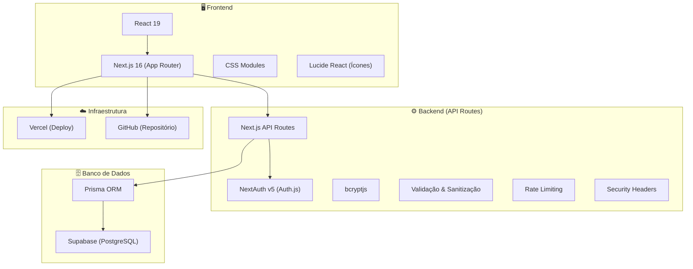
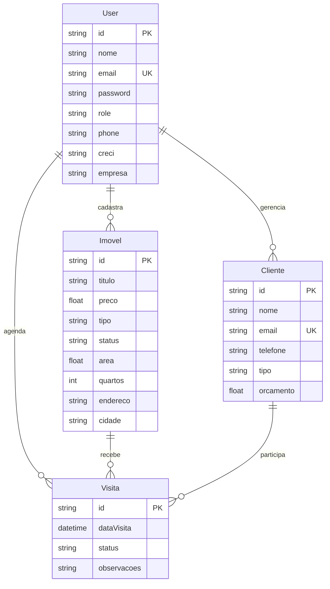

# 🏠 ImóvelPro — Stack Tecnológica & Guia de Apresentação

---

## 📦 Stack Tecnológica Completa

### Diagrama de Arquitetura

---

### Tabela Detalhada de Tecnologias

#### 🎨 Frontend

| Tecnologia | Versão | Função |
|---|---|---|
| **React** | 19.2.6 | Biblioteca de UI — renderização de componentes reativos |
| **Next.js** | 16.2.6 | Framework fullstack com App Router, SSR/SSG, API routes |
| **CSS Modules** | Nativo | Estilização com escopo local por componente (`.module.css`) |
| **Lucide React** | 1.16.0 | Biblioteca de ícones SVG modernos e leves |
| **TypeScript** | 5.9.3 | Tipagem estática para segurança e produtividade |

#### ⚙️ Backend

| Tecnologia | Versão | Função |
|---|---|---|
| **Next.js API Routes** | 16.2.6 | API REST integrada ao framework (serverless) |
| **NextAuth (Auth.js)** | 5.0.0-beta.19 | Autenticação com Credentials Provider + JWT |
| **bcryptjs** | 2.4.3 | Hashing seguro de senhas (bcrypt) |
| **Validação customizada** | — | Input validation, sanitização e rate limiting próprios |

#### 🗄️ Banco de Dados

| Tecnologia | Versão | Função |
|---|---|---|
| **Prisma ORM** | 7.8.0 | ORM type-safe para modelagem e queries do banco |
| **Prisma Adapter PG** | 7.8.0 | Adaptador para conexão direta com PostgreSQL |
| **Supabase** | SDK 2.0 | BaaS com PostgreSQL gerenciado + autenticação |
| **@supabase/ssr** | 0.10.3 | Integração Supabase com SSR do Next.js |

#### 🛠️ Ferramentas de Desenvolvimento

| Tecnologia | Função |
|---|---|
| **ESLint** | Linting e padronização de código |
| **TypeScript** | Compilador e verificação de tipos |
| **ts-node** | Execução direta de TypeScript (seeds) |
| **Prisma Studio** | GUI para visualizar/editar dados do banco |

#### ☁️ Infraestrutura & Deploy

| Tecnologia | Função |
|---|---|
| **Vercel** | Plataforma de deploy (serverless, CDN, CI/CD automático) |
| **GitHub** | Controle de versão e colaboração |

---

## 🏗️ Arquitetura do Projeto

### Padrões Arquiteturais Utilizados

| Padrão | Onde é Aplicado |
|---|---|
| **App Router (File-based routing)** | Roteamento baseado em diretórios em `src/app/` |
| **Route Groups** | `(auth)` e `(dashboard)` para organização de layouts |
| **API Routes (REST)** | CRUD completo em `src/app/api/` |
| **CSS Modules** | Estilização com escopo por componente |
| **Middleware** | Proteção de rotas e verificação de sessão |
| **Repository Pattern** | Prisma Client como camada de acesso a dados |
| **Input Validation** | Validação e sanitização centralizada em `src/lib/` |
| **Rate Limiting** | Proteção contra abuso de API |

### Modelos de Dados (4 entidades)

### Componentes Reutilizáveis (7)

| Componente | Função |
|---|---|
| `Sidebar` | Navegação lateral com links e logout |
| `Button` | Botão estilizado com variantes |
| `Card` | Container visual para conteúdo |
| `Modal` | Diálogo para formulários e confirmações |
| `Toast` | Notificações temporárias (sucesso/erro) |
| `Skeleton` | Loading placeholder animado |
| `EmptyState` | Estado vazio com ilustração |

---

## 🎤 Como Apresentar o Projeto

### 📚 Para Apresentação Acadêmica (TCC / Projeto de Faculdade)

**Roteiro sugerido (~15 min):**

1. **Problema & Motivação** (2 min)
   - Corretores usam planilhas e WhatsApp para gerenciar imóveis
   - Falta de organização gera perda de oportunidades
   - Mercado imobiliário em digitalização

2. **Solução Proposta** (2 min)
   - SaaS voltado para corretores autônomos e pequenas imobiliárias
   - Plataforma web responsiva e completa
   - Modelo multi-tenant (cada corretor vê apenas seus dados)

3. **Tecnologias & Justificativas** (3 min)
   - **Next.js**: Framework fullstack que elimina a necessidade de um backend separado
   - **Prisma + Supabase**: ORM type-safe com banco gerenciado (baixo custo operacional)
   - **NextAuth**: Padrão de mercado para autenticação em apps Next.js
   - **TypeScript**: Redução de bugs e manutenibilidade

4. **Demonstração ao vivo** (5 min)
   - Fluxo de login → Dashboard → Cadastrar imóvel → Cadastrar cliente → Agendar visita
   - Mostrar responsividade (redimensionar tela)
   - Mostrar filtros e estatísticas do dashboard

5. **Arquitetura & Segurança** (2 min)
   - Mostrar diagrama de arquitetura
   - Mencionar: hashing bcrypt, JWT, rate limiting, validação de input, middleware de proteção

6. **Conclusão & Próximos Passos** (1 min)
   - Upload de imagens, relatórios PDF, integração com mapas
   - Possível monetização como SaaS

---

### 💼 Para Portfólio / Entrevista de Emprego

**Pontos fortes para destacar:**

> [!TIP]
> Recrutadores valorizam projetos que demonstram resolução de problemas reais, não apenas uso de tecnologias.

- ✅ **Projeto fullstack completo** — não é um tutorial ou TODO list
- ✅ **Stack moderna e de mercado** — Next.js 16, React 19, TypeScript, Prisma
- ✅ **Preocupação com segurança** — bcrypt, rate limiting, validação, sanitização
- ✅ **Código organizado** — componentes reutilizáveis, CSS Modules, separação clara
- ✅ **Banco de dados relacional real** — 4 entidades com relacionamentos
- ✅ **Deploy funcional** — não é apenas local, está pronto para Vercel
- ✅ **Responsivo** — funciona em mobile

**Como falar sobre o projeto em 2 minutos:**
> "Desenvolvi um SaaS para o mercado imobiliário usando Next.js 16 com App Router, TypeScript e Prisma com Supabase. A aplicação permite que corretores gerenciem imóveis, clientes e visitas com autenticação segura via NextAuth. Implementei segurança com bcrypt, rate limiting e validação de input. O projeto usa CSS Modules para estilização e tem uma arquitetura modular com 7 componentes reutilizáveis."

---

### 🎥 Para Vídeo / Demo Online

**Ordem recomendada de demonstração:**

1. Landing page (se houver)
2. Tela de registro → criar conta
3. Dashboard com estatísticas
4. Cadastrar um imóvel com todos os campos
5. Cadastrar um cliente
6. Agendar uma visita vinculando imóvel + cliente
7. Mostrar filtros funcionando
8. Editar perfil
9. Mostrar responsividade no mobile

---

## 💡 Diferenciais para Destacar

| Diferencial | Por que importa |
|---|---|
| **Multi-tenant por design** | Cada corretor só vê seus próprios dados (isolamento via `userId`) |
| **Stack 100% TypeScript** | Type-safety end-to-end, do banco ao frontend |
| **Segurança em camadas** | Não é apenas autenticação — tem rate limiting, validação, sanitização e headers |
| **Prisma ORM com PostgreSQL** | Modelagem profissional com migrações e seed |
| **CSS Modules (sem framework CSS)** | Demonstra domínio de CSS puro, não dependência de Tailwind |
| **App Router (Next.js moderno)** | Uso do padrão mais atual do Next.js, não do legado Pages Router |
| **Componentes de UX** | Skeleton loading, Toast notifications, Empty states — atenção ao UX |

---

## ⚠️ Pontos a Melhorar (para menção honesta em apresentação)

- [ ] Testes automatizados (unitários e E2E)
- [ ] Upload real de imagens (atualmente o campo existe mas sem implementação)
- [ ] Relatórios em PDF
- [ ] Integração com mapas (Google Maps / Leaflet)
- [ ] Notificações por email
- [ ] CI/CD pipeline configurado
- [ ] Documentação da API (Swagger/OpenAPI)

> [!TIP]
> Mencionar pontos a melhorar demonstra maturidade técnica. Recrutadores e bancas avaliadoras valorizam a autocrítica.
